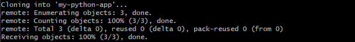
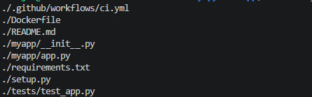
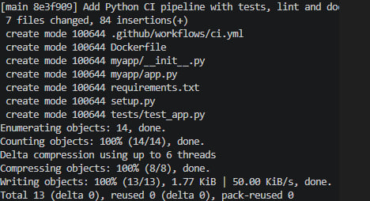
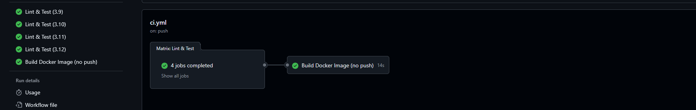
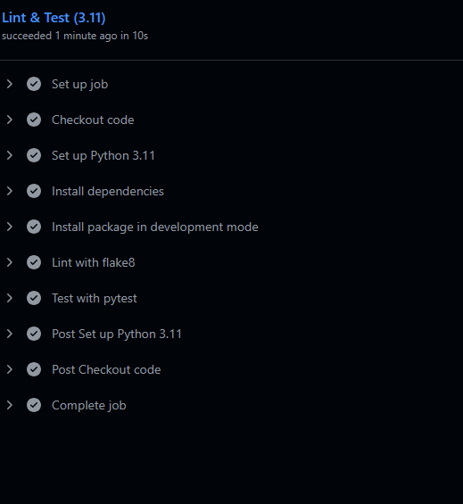
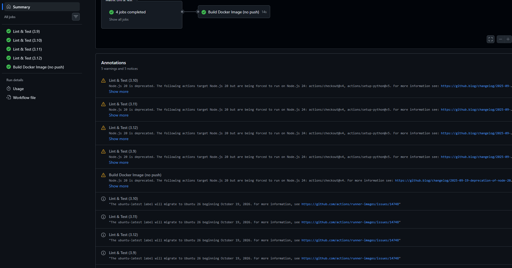
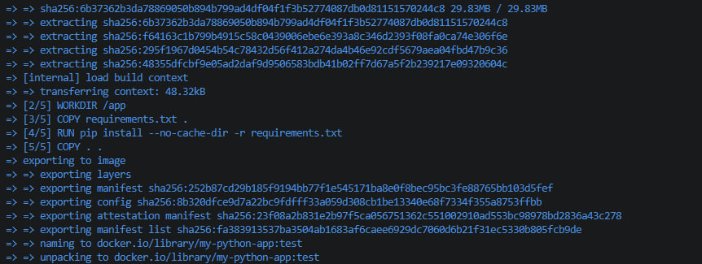

## Скриншоты

### 1. Список workflow в Actions

### 2. Jobs (матрица Python + Docker)

### 3. Вывод pytest

### 4. Локальная сборка Docker-образа

### 5. Запуск контейнера

### 6. Вывод контейнера

### 7. Дополнительно

