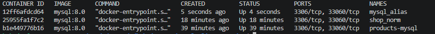
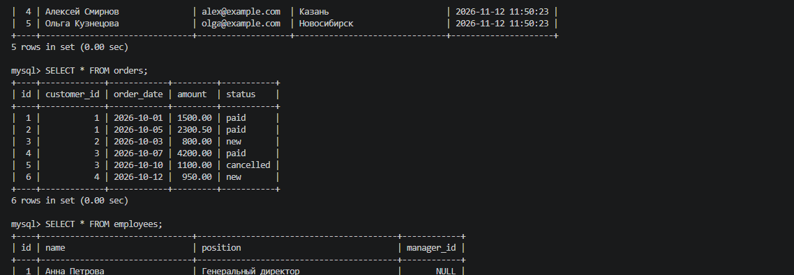
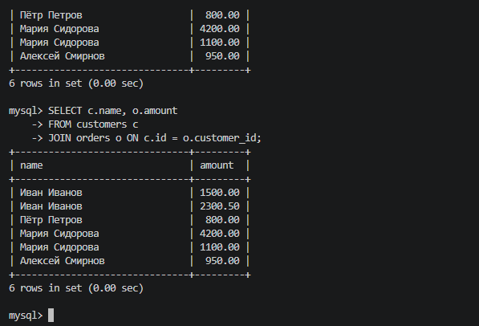
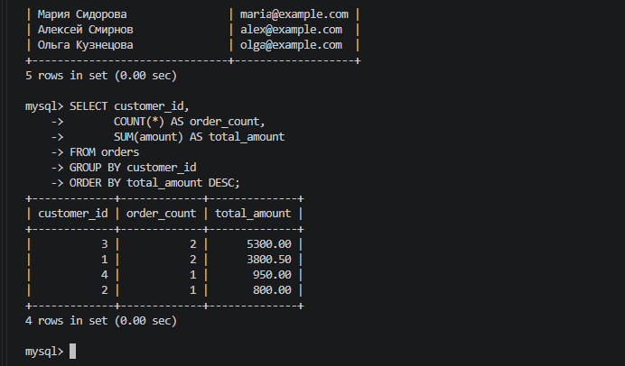
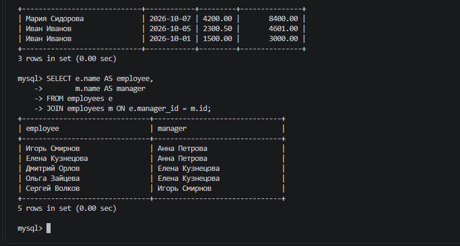
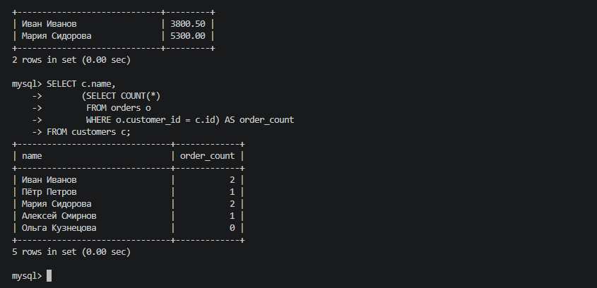
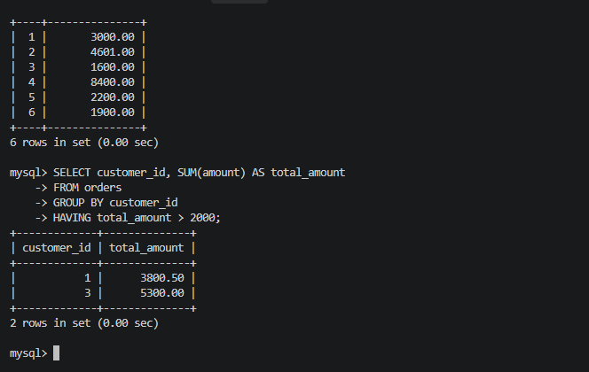
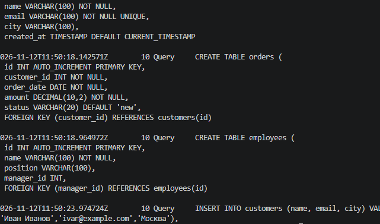
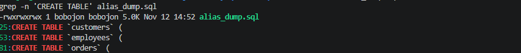

# Лабораторная работа № 6: Использование псевдонимов (алиасов) в MySQL

**Предмет:** Базовые принципы проектирования баз данных  
**Задание:** [Aliases.md — учебное руководство по алиасам в SQL](https://github.com/rurewa/imfua/blob/main/content/Courses/Basics_database_design/content/bd/Aliases.md)  
**Применяемый стек технологий:** MySQL 8.0, Docker Desktop, WSL Ubuntu, VS Code, Git.

## Цель исследования

Освоить применение **псевдонимов (алиасов) для таблиц и полей** в SQL-инструкциях, включая операции `JOIN`, агрегатные вычисления и вложенные запросы. Продемонстрировать классическую ошибку обращения к алиасу в условии `WHERE`, а также зафиксировать дамп базы данных и историю выполненных SQL-команд.

## Архитектура проекта

```text
mysql-alias-practice/
├── README.md
├── my.cnf
├── alias_dump.sql
├── general.log
├── my_actions.log
└── screenshots/
    ├── 01-container.png
    ├── 02-data.png
    ├── 03-table-aliases.png
    ├── 04-column-aliases.png
    ├── 05-joins.png
    ├── 06-subqueries.png
    ├── 07-alias-errors.png
    ├── 08-log.png
    └── 09-dump.png
```

## 1. Инициализация MySQL-сервера в Docker

Конфигурационный файл [`my.cnf`](my.cnf) заранее настроен на использование кодировки `utf8mb4` и ведение журнала всех SQL-запросов в файле `/var/lib/mysql/general.log`:

```ini
[mysqld]
character-set-server = utf8mb4
collation-server = utf8mb4_unicode_ci
general_log = 1
general_log_file = /var/lib/mysql/general.log
log_output = FILE

[client]
default-character-set = utf8mb4

[mysql]
default-character-set = utf8mb4
```

Для выполнения задания был развернут изолированный контейнер с именем `mysql_alias`, использующий именованный том `mysql_alias_data` для постоянного хранения данных:

```bash
docker run --name mysql_alias \
  -e MYSQL_ROOT_PASSWORD=123 \
  -e LANG=C.UTF-8 \
  -e MYSQL_INITDB_SKIP_TZINFO=1 \
  -v mysql_alias_data:/var/lib/mysql \
  -v "$HOME/mysql-alias-config/my.cnf:/etc/mysql/conf.d/my.cnf:ro" \
  -d mysql:8.0

docker ps
```

По завершении начальной инициализации системы общий лог был очищен во избежание накопления избыточных системных записей.



## 2. Генерация базы данных и структуры таблиц

Была развернута база данных `alias_db`, включающая три связанные таблицы:

| Таблица | Функциональное назначение |
|---|---|
| `customers` | Хранение данных о клиентах: имя, email, город |
| `orders` | Информация о заказах: суммы, даты оформления и текущие статусы |
| `employees` | Сведения о персонале и иерархия подчинения (руководители) |

```sql
CREATE DATABASE alias_db
  CHARACTER SET utf8mb4 COLLATE utf8mb4_unicode_ci;
USE alias_db;

CREATE TABLE customers (
    id INT AUTO_INCREMENT PRIMARY KEY,
    name VARCHAR(100) NOT NULL,
    email VARCHAR(100) NOT NULL UNIQUE,
    city VARCHAR(100),
    created_at TIMESTAMP DEFAULT CURRENT_TIMESTAMP
);

CREATE TABLE orders (
    id INT AUTO_INCREMENT PRIMARY KEY,
    customer_id INT NOT NULL,
    order_date DATE NOT NULL,
    amount DECIMAL(10,2) NOT NULL,
    status VARCHAR(20) DEFAULT 'new',
    FOREIGN KEY (customer_id) REFERENCES customers(id)
);

CREATE TABLE employees (
    id INT AUTO_INCREMENT PRIMARY KEY,
    name VARCHAR(100) NOT NULL,
    position VARCHAR(100),
    manager_id INT,
    FOREIGN KEY (manager_id) REFERENCES employees(id)
);
```

Указанные таблицы были заполнены тестовым набором данных: **5 записей клиентов, 6 заказов и 6 сотрудников**. Корректность внесения информации проверялась следующими инструкциями:

```sql
SELECT * FROM customers;
SELECT * FROM orders;
SELECT * FROM employees;
```



## 3. Псевдонимы для таблиц

Демонстрация разницы между стандартным запросом и запросом с применением сокращенных обозначений `c` и `o`:

```sql
-- Без алиасов
SELECT customers.name, orders.amount
FROM customers
JOIN orders ON customers.id = orders.customer_id;

-- С алиасами
SELECT c.name, o.amount
FROM customers c
JOIN orders o ON c.id = o.customer_id;
```

Итоговый набор данных в обоих случаях идентичен, однако второй вариант отличается лаконичностью и лучшей читаемостью. Важно помнить, что область видимости алиаса таблицы ограничивается рамками текущего SQL-запроса.



## 4. Псевдонимы полей и агрегатные операции

Ключевое слово `AS` дает возможность присвоить интуитивно понятное имя выходному столбцу или результату математической операции:

```sql
SELECT name AS customer_name,
       email AS contact_email
FROM customers;

SELECT customer_id,
       COUNT(*) AS order_count,
       SUM(amount) AS total_amount
FROM orders
GROUP BY customer_id
ORDER BY total_amount DESC;
```

Названия `customer_name`, `order_count` и `total_amount` существенно повышают информативность выборки. Кроме того, алиас `total_amount` успешно применяется в директиве сортировки.



## 5. Использование алиасов в JOIN и самосоединении

Извлечение информации об оплаченных заказах с добавлением вычисляемого поля:

```sql
SELECT c.name AS customer,
       o.order_date,
       o.amount,
       o.amount * 2 AS double_amount
FROM customers c
JOIN orders o ON c.id = o.customer_id
WHERE o.status = 'paid'
ORDER BY double_amount DESC;
```

Механизм самосоединения таблицы `employees` дает возможность вывести данные о сотруднике и его непосредственном начальнике, обращаясь к **одной и той же таблице**:

```sql
SELECT e.name AS employee,
       m.name AS manager
FROM employees e
JOIN employees m ON e.manager_id = m.id;
```

В данном контексте `e` ссылается на подчиненного, а `m` — на его руководителя.



## 6. Алиасы во вложенных запросах

В первой демонстрации подзапрос функционирует в роли производной таблицы `o`, а во втором варианте подсчитывается общее количество заказов для каждого покупателя:

```sql
SELECT c.name, o.total
FROM customers c
JOIN (
    SELECT customer_id, SUM(amount) AS total
    FROM orders
    GROUP BY customer_id
) o ON c.id = o.customer_id
WHERE o.total > 2000;

SELECT c.name,
       (SELECT COUNT(*)
        FROM orders o
        WHERE o.customer_id = c.id) AS order_count
FROM customers c;
```

Псевдонимы играют ключевую роль в разграничении источников данных и обеспечении доступа к результатам, возвращаемым подзапросами.



## 7. Типичная ошибка: обращение к алиасу в условии WHERE

Попытка фильтрации по алиасу, который был определен в блоке `SELECT`, приводит к сбою:

```sql
-- Ошибка: Unknown column 'double_amount' in 'where clause'
SELECT id, amount * 2 AS double_amount
FROM orders
WHERE double_amount > 1000;
```

Корректный подход требует дублирования исходного выражения непосредственно в условии фильтрации:

```sql
SELECT id, amount * 2 AS double_amount
FROM orders
WHERE amount * 2 > 1000;
```

Если же необходимо отфильтровать сгруппированные данные по агрегатному значению, следует применять оператор `HAVING`:

```sql
SELECT customer_id, SUM(amount) AS total_amount
FROM orders
GROUP BY customer_id
HAVING total_amount > 2000;
```

**Резюме:** псевдонимы столбцов допустимы в конструкции `ORDER BY`, но недоступны в `WHERE`; при этом СУБД MySQL разрешает их использование в `HAVING`.



## 8. Фиксация SQL-запросов в журнале

В процессе выполнения задания все инструкции фиксировались в общем логе MySQL. По завершении тестов функция логирования была деактивирована, а сам файл журнала извлечен в рабочую директорию проекта:

```bash
docker exec -e MYSQL_PWD=123 mysql_alias mysql -uroot \
  -e "SET GLOBAL general_log='OFF';"

docker cp mysql_alias:/var/lib/mysql/general.log ./general.log
```

На базе общего лога был также сформирован отдельный файл [`my_actions.log`](my_actions.log), содержащий исключительно учебные SQL-инструкции. Полный журнал сохранен под именем [`general.log`](general.log).



## 9. Формирование резервной копии базы данных

С применением утилиты `mysqldump` была создана полная SQL-копия базы `alias_db`:

```bash
docker exec -e MYSQL_PWD=123 mysql_alias mysqldump -uroot \
  --set-gtid-purged=OFF \
  --single-transaction \
  alias_db > alias_dump.sql
```

Результирующий файл [`alias_dump.sql`](alias_dump.sql) включает в себя как схему, так и все тестовые записи таблиц `customers`, `orders` и `employees`.



## Итоги работы

В рамках данной лабораторной работы были детально рассмотрены **псевдонимы таблиц и полей**, а также практические сценарии их использования в операциях `JOIN`, самосоединениях, математических вычислениях, сортировке и вложенных запросах. Была наглядно разобрана причина невозможности применения алиаса из `SELECT` в блоке `WHERE`. Состояние базы данных зафиксировано в виде SQL-дампа, а история выполненных операций сохранена в лог-файлах.
```