# Лабораторная работа № 2: Интерактивное взаимодействие с MySQL внутри Docker

**Тема:** эксплуатация СУБД MySQL 8.0 в обособленном Docker-контейнере: формирование SQL-запросов, установление связей между таблицами, работа с представлениями (VIEW), ведение журналов событий, а также резервное копирование и последующее восстановление данных.

**Задание:** [«Интерактивная работа с MySQL в изолированном окружении Docker № 2»](https://github.com/rurewa/imfua/blob/main/content/Courses/Basics_database_design/content/bd/Begin_MySQL_2.md)

## Цель исследования

Совершенствование компетенций по администрированию MySQL в среде Docker: проектирование связанных таблиц на базе движка InnoDB, манипуляция данными, исполнение запросов с условиями фильтрации, группировкой, объединениями и вложенными подзапросами; конфигурация общего лога SQL-команд, генерация дампа и валидация процедуры восстановления базы данных.

## Реализованные задачи

- Взят за основу контейнер `my-mysql` с MySQL 8.0, инициализированный в ходе первой практической работы.
- Активирована кодировка `utf8mb4` и настроено сохранение общего журнала запросов в системную таблицу `mysql.general_log`.
- Сформировано представление `my_actions` для удобного мониторинга пользовательских запросов из лога.
- Развернуты связанные таблицы `customers` и `orders` с определением первичных и внешних ключей.
- Таблицы наполнены тестовыми наборами данных о клиентах и их заказах.
- Протестирован широкий спектр SQL-конструкций: `SELECT`, `WHERE`, `ORDER BY`, `LIMIT`, `LIKE`, `BETWEEN`, `IN`, агрегатные функции, `GROUP BY`, `HAVING`, различные типы `JOIN`, подзапросы, операторы `EXISTS`, `UNION` и `UNION ALL`.
- Опробованы команды модификации и удаления: `UPDATE`, `DELETE`, `ALTER TABLE`.
- Отфильтрованный журнал действий экспортирован во внешний файл `my_actions_export.txt`.
- Сгенерирован резервный дамп `dump_clean.sql`; после этого база данных была удалена и успешно восстановлена из созданной копии.
- Задокументировано **18 скриншотов**, иллюстрирующих ключевые этапы выполнения задания.

## Архитектура проекта

```text
mysql-docker-practice-2/
├── README.md                  # Отчёт о выполненной практике
├── dump_clean.sql             # Резервная копия sql_practice
├── my_actions_export.txt      # Экспорт отфильтрованного журнала запросов
└── screenshots/
    ├── 01-container.png
    ├── 02-logging.png
    ├── 03-view.png
    ├── 04-tables.png
    ├── 05-database-files.png
    ├── 06-insert.png
    ├── 07-select.png
    ├── 08-aggregates.png
    ├── 09-groupby.png
    ├── 10-joins.png
    ├── 11-subqueries.png
    ├── 12-union.png
    ├── 13-update-delete.png
    ├── 14-alter.png
    ├── 15-logs.png
    ├── 16-dump.png
    ├── 17-drop.png
    └── 18-restore.png
```

> **Примечание.** Конфигурационный файл `my.cnf` заимствован из первой части практики (`mysql-docker-practice/my.cnf`). В рамках текущего задания для вывода лога установлен параметр `log_output = TABLE`. Изображения расположены в директории `screenshots` и встроены в соответствующие разделы ниже.

## Ход выполнения работы

### 1. Валидация и запуск Docker-контейнера

Проверено состояние контейнера MySQL. После внесения правок в конфигурацию сервис был перезапущен.

```bash
docker ps -a
docker restart my-mysql
docker ps
```

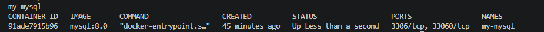

### 2. Конфигурация журналирования MySQL

Общий лог активирован с маршрутизацией записей в таблицу `mysql.general_log`.

```ini
[mysqld]
character-set-server = utf8mb4
collation-server = utf8mb4_unicode_ci
general_log = 1
log_output = TABLE

[client]
default-character-set = utf8mb4

[mysql]
default-character-set = utf8mb4
```

Для подключения использована команда:

```bash
docker exec -it my-mysql mysql --default-character-set=utf8mb4 -uroot -p
```

Настройки проверены запросами:

```sql
SET GLOBAL general_log = 'ON';
SET GLOBAL log_output = 'TABLE';
SHOW VARIABLES LIKE 'general_log%';
SHOW VARIABLES LIKE 'log_output';
```

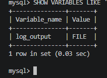

### 3. Инициализация базы данных и создание представления VIEW

В качестве рабочей среды выбрана БД `sql_practice`. Для отслеживания действий пользователя сформировано представление `my_actions`, извлекающее записи из общего журнала.

```sql
CREATE DATABASE IF NOT EXISTS sql_practice
  CHARACTER SET utf8mb4 COLLATE utf8mb4_unicode_ci;
USE sql_practice;

CREATE OR REPLACE VIEW my_actions AS
SELECT event_time,
       command_type,
       CONVERT(argument USING utf8mb4) AS argument
FROM mysql.general_log
WHERE user_host LIKE '%root%'
  AND command_type = 'Query'
  AND argument NOT LIKE 'SET %'
  AND argument NOT LIKE 'SHOW %'
  AND argument NOT LIKE 'SELECT @@%'
  AND argument NOT LIKE 'SELECT DATABASE()%'
  AND argument NOT LIKE 'SELECT * FROM my_actions%'
  AND argument NOT LIKE 'TRUNCATE TABLE mysql.general_log%'
  AND argument NOT LIKE 'CREATE OR REPLACE VIEW my_actions%';

SHOW FULL TABLES WHERE Table_type = 'VIEW';
SELECT * FROM my_actions ORDER BY event_time DESC LIMIT 20;
```

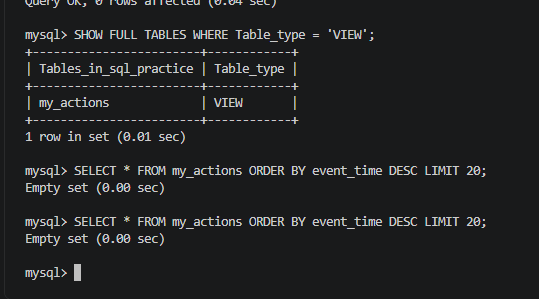

### 4. Проектирование связанных таблиц

Развернуты таблицы `customers` (покупатели) и `orders` (заказы). Атрибут `orders.customer_id` настроен как внешний ключ, ссылающийся на первичный ключ `customers.id`.

```sql
CREATE TABLE customers (
    id INT AUTO_INCREMENT PRIMARY KEY,
    name VARCHAR(100) NOT NULL,
    email VARCHAR(100) NOT NULL UNIQUE,
    city VARCHAR(100),
    created_at TIMESTAMP DEFAULT CURRENT_TIMESTAMP
) ENGINE=InnoDB CHARACTER SET utf8mb4 COLLATE utf8mb4_unicode_ci;

CREATE TABLE orders (
    id INT AUTO_INCREMENT PRIMARY KEY,
    customer_id INT NOT NULL,
    order_date DATE NOT NULL,
    amount DECIMAL(10, 2) NOT NULL,
    status VARCHAR(20) DEFAULT 'new',
    FOREIGN KEY (customer_id) REFERENCES customers(id)
) ENGINE=InnoDB CHARACTER SET utf8mb4 COLLATE utf8mb4_unicode_ci;

SHOW TABLES;
DESCRIBE customers;
DESCRIBE orders;
```

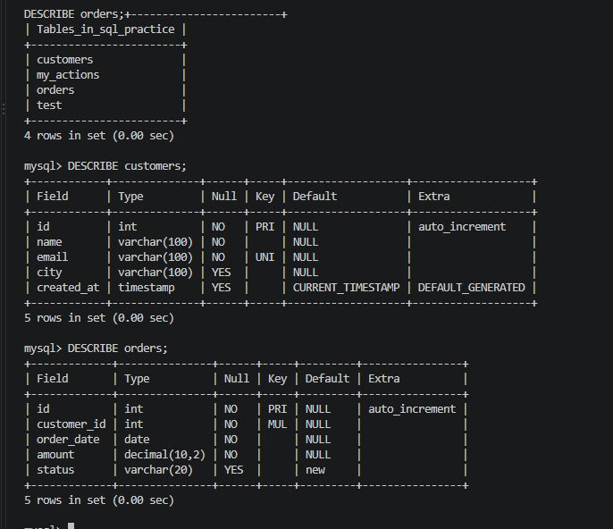

### 5. Аудит файлов движка InnoDB

После завершения сеанса в клиенте MySQL был проверен состав файлов внутри директории базы данных в контейнере.

```bash
docker exec -it my-mysql ls -la /var/lib/mysql/sql_practice
```

В каталоге присутствуют файлы `customers.ibd` и `orders.ibd`.

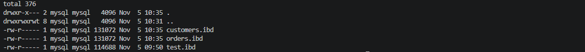

### 6. Наполнение таблиц данными (INSERT)

Добавлено пять записей клиентов и шесть заказов; корректность внесения проверена через `SELECT`.

```sql
USE sql_practice;

INSERT INTO customers (name, email, city) VALUES
  ('Иван Иванов', 'ivan@example.com', 'Москва'),
  ('Пётр Петров', 'petr@example.com', 'Санкт-Петербург'),
  ('Мария Сидорова', 'maria@example.com', 'Москва'),
  ('Алексей Смирнов', 'alex@example.com', 'Казань'),
  ('Ольга Кузнецова', 'olga@example.com', 'Новосибирск');

INSERT INTO orders (customer_id, order_date, amount, status) VALUES
  (1, '2026-10-01', 1500.00, 'paid'),
  (1, '2026-10-05', 2300.50, 'paid'),
  (2, '2026-10-03', 800.00, 'new'),
  (3, '2026-10-07', 4200.00, 'paid'),
  (3, '2026-10-10', 1100.00, 'cancelled'),
  (4, '2026-10-12', 950.00, 'new');

SELECT * FROM customers;
SELECT * FROM orders;
```

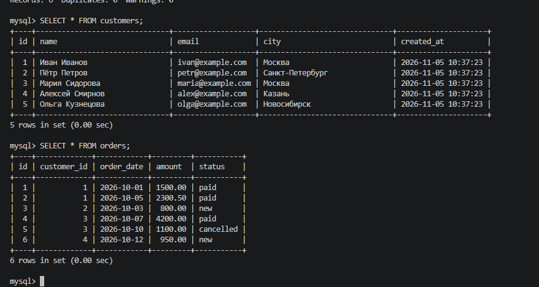

### 7. Выборка и фильтрация данных (SELECT)

Протестированы извлечение конкретных столбцов, применение условий `WHERE`, сортировка результатов, ограничение выборки и поиск по маске.

```sql
SELECT name, city FROM customers;
SELECT * FROM customers WHERE city = 'Москва';
SELECT * FROM orders WHERE amount > 1000;
SELECT * FROM orders WHERE status = 'paid' AND amount > 1500;
SELECT * FROM orders ORDER BY amount DESC LIMIT 3;
SELECT * FROM customers WHERE name LIKE 'И%';
SELECT * FROM orders WHERE amount BETWEEN 1000 AND 3000;
SELECT * FROM customers WHERE city IN ('Москва', 'Казань');
SELECT * FROM customers WHERE city IS NULL;
```

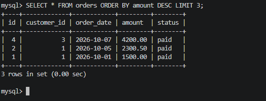

### 8. Применение агрегатных функций

С использованием `COUNT`, `SUM`, `AVG`, `MIN` и `MAX` выполнена статистическая оценка сумм заказов.

```sql
SELECT COUNT(*) AS total_orders FROM orders;
SELECT SUM(amount) AS total_sum FROM orders;
SELECT AVG(amount) AS avg_amount FROM orders;
SELECT MIN(amount) AS min_amount, MAX(amount) AS max_amount FROM orders;
```

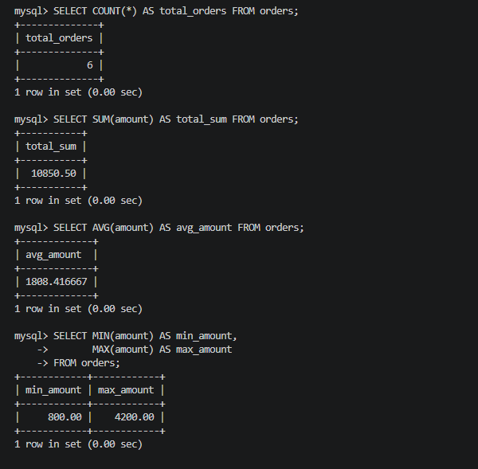

### 9. Группировка данных: GROUP BY и HAVING

Подсчитано число заказов и их общая стоимость в разрезе каждого клиента; результирующие группы отфильтрованы по пороговому значению суммы.

```sql
SELECT customer_id, COUNT(*) AS order_count, SUM(amount) AS total_amount
FROM orders
GROUP BY customer_id;

SELECT c.name, COUNT(o.id) AS order_count, SUM(o.amount) AS total_amount
FROM customers c
JOIN orders o ON c.id = o.customer_id
GROUP BY c.id, c.name
ORDER BY total_amount DESC;

SELECT customer_id, SUM(amount) AS total_amount
FROM orders
GROUP BY customer_id
HAVING SUM(amount) > 2000;
```

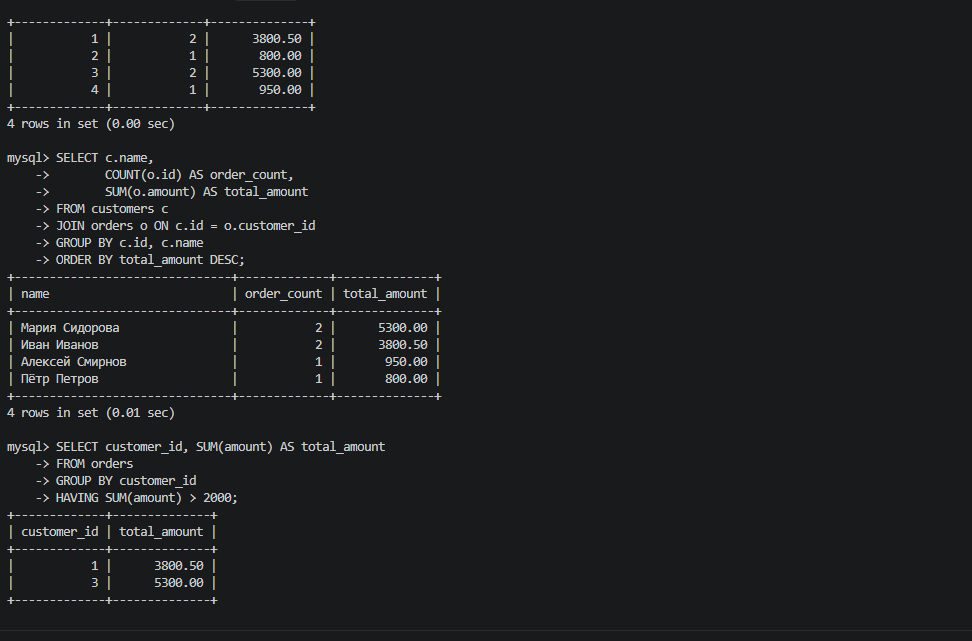

### 10. Объединение таблиц (JOIN)

Проверена работа `INNER JOIN`, `LEFT JOIN` и `RIGHT JOIN`, включая комбинацию с агрегацией. Для обработки клиентов без активных заказов применена функция `COALESCE`.

```sql
SELECT c.name, o.order_date, o.amount, o.status
FROM customers c
INNER JOIN orders o ON c.id = o.customer_id;

SELECT c.name, o.id AS order_id, o.amount
FROM customers c
LEFT JOIN orders o ON c.id = o.customer_id;

SELECT c.name, o.id AS order_id
FROM customers c
RIGHT JOIN orders o ON c.id = o.customer_id;

SELECT c.name,
       COUNT(o.id) AS order_count,
       COALESCE(SUM(o.amount), 0) AS total_amount
FROM customers c
LEFT JOIN orders o ON c.id = o.customer_id
GROUP BY c.id, c.name
ORDER BY total_amount DESC;
```

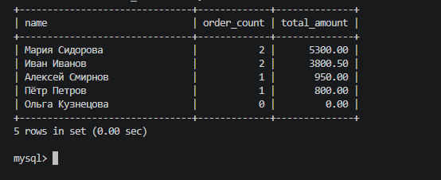

### 11. Вложенные запросы и оператор EXISTS

Реализованы подзапросы в секциях `WHERE`, `FROM` и `SELECT`, а также проверка наличия записей посредством `EXISTS` и `NOT EXISTS`.

```sql
SELECT name, city
FROM customers
WHERE id IN (
    SELECT customer_id FROM orders WHERE amount > 1000
);

SELECT c.name,
       (SELECT COUNT(*) FROM orders o WHERE o.customer_id = c.id) AS order_count
FROM customers c;

SELECT name FROM customers c
WHERE EXISTS (
    SELECT 1 FROM orders o WHERE o.customer_id = c.id
);

SELECT name FROM customers c
WHERE NOT EXISTS (
    SELECT 1 FROM orders o WHERE o.customer_id = c.id
);
```

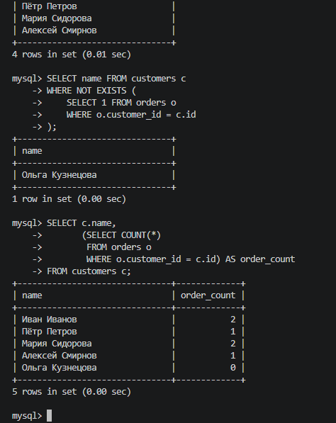

### 12. Операции UNION и UNION ALL

Продемонстрировано слияние результатов нескольких выборок: `UNION` удаляет дубликаты строк, тогда как `UNION ALL` сохраняет их в исходном виде.

```sql
SELECT name, city FROM customers WHERE city = 'Москва'
UNION
SELECT name, city FROM customers WHERE city = 'Казань';

SELECT city FROM customers
UNION ALL
SELECT city FROM customers;
```

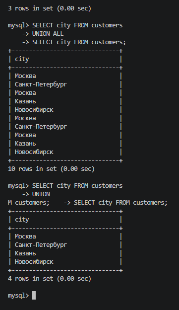

### 13. Модификация и удаление записей

Посредством `UPDATE` обновлены город проживания клиента и статус заказа. Далее оператор `DELETE` удалил запись заказа с идентификатором 6.

```sql
UPDATE customers SET city = 'Екатеринбург' WHERE id = 4;
UPDATE orders SET status = 'paid' WHERE id = 3;
SELECT * FROM customers WHERE id = 4;
SELECT * FROM orders WHERE id = 3;

DELETE FROM orders WHERE id = 6;
SELECT * FROM orders;
```

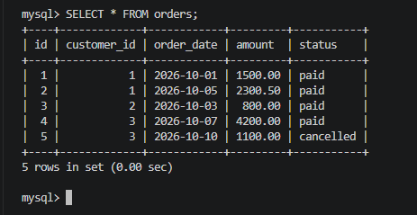

### 14. Модификация структуры таблицы (ALTER TABLE)

В таблицу клиентов добавлен атрибут `phone`, впоследствии изменён его тип данных, после чего столбец был удалён.

```sql
ALTER TABLE customers ADD COLUMN phone VARCHAR(20);
UPDATE customers SET phone = '123-36-77' WHERE id = 4;
SELECT * FROM customers WHERE id = 4;

ALTER TABLE customers MODIFY COLUMN phone VARCHAR(30);
ALTER TABLE customers DROP COLUMN phone;
SELECT * FROM customers;
```

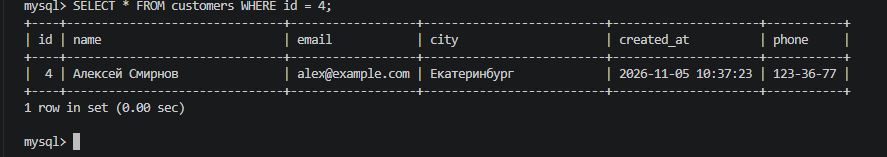

### 15. Анализ и экспорт журнала запросов

Выполненные команды просмотрены через представление `my_actions`, затем результат был выгружен из контейнера в текстовый документ.

```sql
SELECT * FROM my_actions ORDER BY event_time DESC LIMIT 20;
SELECT * FROM my_actions
WHERE argument LIKE '%customers%'
ORDER BY event_time DESC LIMIT 10;
```

Команда экспорта в терминале WSL:

```bash
docker exec -e MYSQL_PWD=123 my-mysql mysql -uroot \
  --default-character-set=utf8mb4 \
  -e "SELECT * FROM sql_practice.my_actions ORDER BY event_time DESC" \
  > my_actions_export.txt
```


### 16. Формирование резервной копии (mysqldump)

Создан полный SQL-дамп базы `sql_practice`. Флаг `--set-gtid-purged=OFF` предотвращает добавление инструкций GTID, а `--single-transaction` гарантирует целостность снимка для таблиц InnoDB.

```bash
docker exec -e MYSQL_PWD=123 my-mysql mysqldump -uroot \
  --set-gtid-purged=OFF \
  --single-transaction \
  sql_practice > dump_clean.sql

ls -lh dump_clean.sql
head -30 dump_clean.sql
```

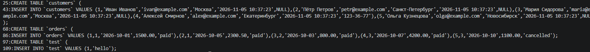

### 17. Ликвидация таблиц и базы данных

После успешного бэкапа таблицы удалены в корректной последовательности: сначала зависимая `orders`, затем `customers`. В завершение удалена сама база `sql_practice`.

```sql
USE sql_practice;
DROP TABLE orders;
SHOW TABLES;
DROP TABLE customers;
SHOW TABLES;
DROP DATABASE sql_practice;
SHOW DATABASES;
```

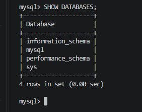

### 18. Реставрация базы данных из дампа

Первоначально воссоздана пустая база `sql_practice`:

```sql
CREATE DATABASE sql_practice
  CHARACTER SET utf8mb4 COLLATE utf8mb4_unicode_ci;
```

Затем в терминале WSL инициирован процесс импорта:

```bash
docker exec -i my-mysql mysql -uroot -p123 sql_practice < dump_clean.sql
```

По завершении восстановления проверены наличие таблиц, представление `my_actions` и целостность сохранённых данных:

```sql
USE sql_practice;
SHOW TABLES;
SHOW FULL TABLES WHERE Table_type = 'VIEW';
SELECT * FROM customers;
SELECT * FROM orders;
SELECT * FROM my_actions LIMIT 5;
```

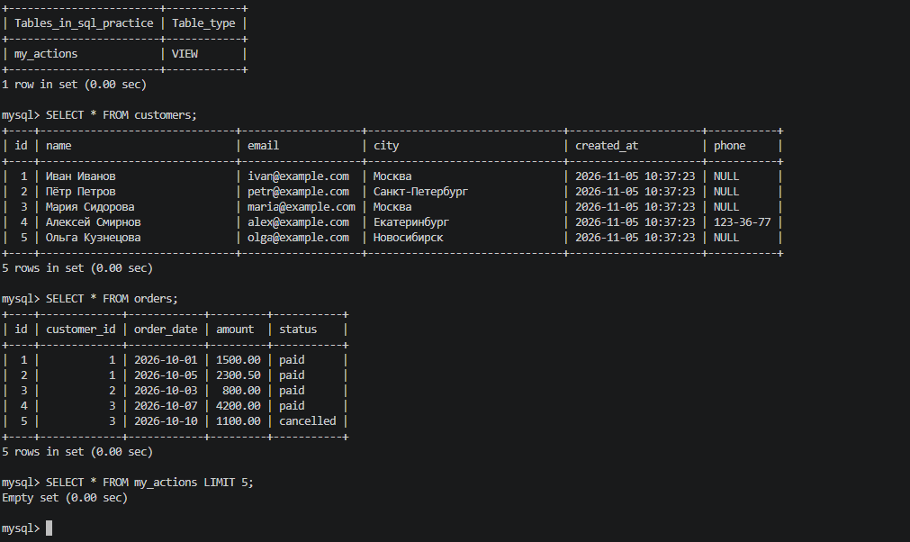

## Итоги работы

В рамках второй практической работы детально изучены ключевые функции SQL в MySQL 8.0 и механизмы взаимодействия с реляционной базой данных внутри Docker. Спроектированы связанные таблицы клиентов и заказов, исполнены запросы различной степени сложности, настроен мониторинг действий через логирование. Отработан полный цикл резервного копирования: **экспорт → удаление БД → восстановление из SQL-дампа → верификация данных**.

## Заключение

Применение Docker обеспечивает безопасную и изолированную среду для экспериментов с MySQL, а движок InnoDB гарантирует поддержку транзакций и внешних ключей. В ходе работы приобретены устойчивые практические навыки манипуляции данными, конструирования сложных SQL-запросов, анализа системных журналов и аварийного восстановления базы данных из резервной копии.

```