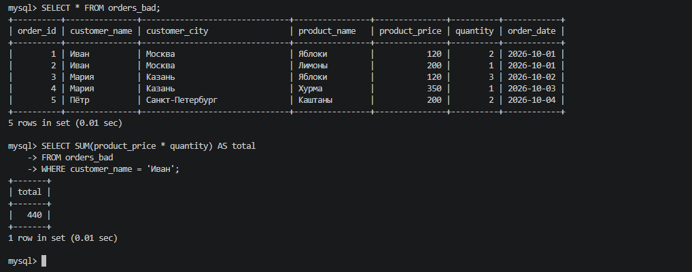
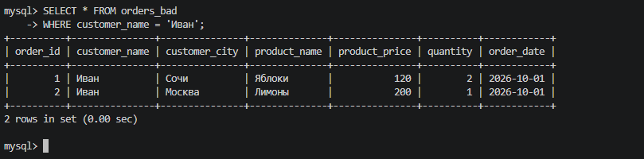
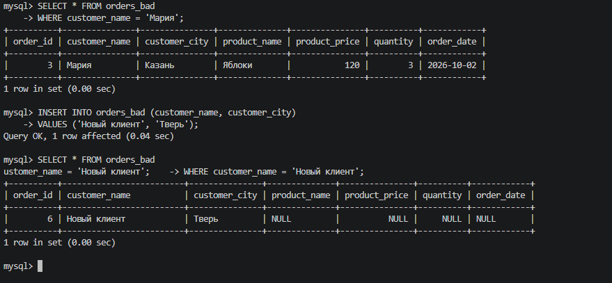
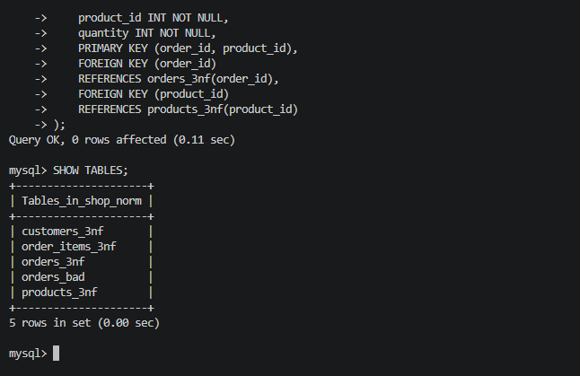
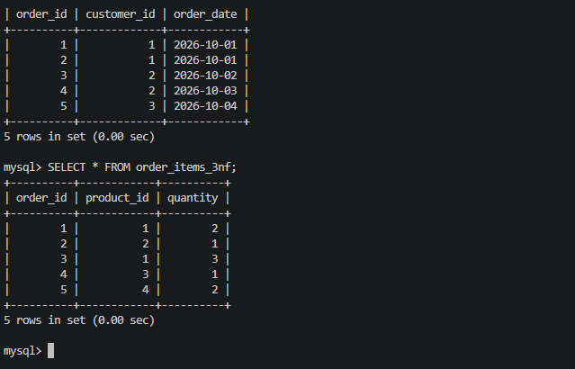
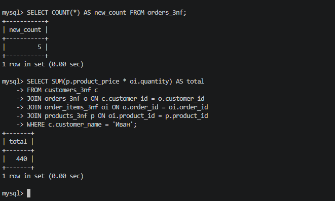
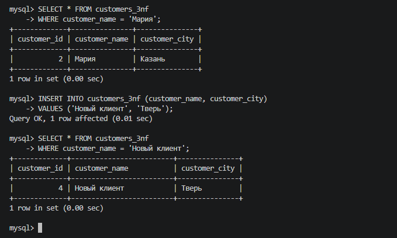

# Лабораторная работа № 5: Нормализация данных в MySQL (приведение к 3NF)

**Предмет:** Основы проектирования баз данных  
**Учебное задание:** `Normalization.md` — «Нормализация данных. Практическое руководство (с ведением лога)»  
**Технологический стек:** MySQL 8.0, Docker Desktop, WSL Ubuntu, VS Code, Git.

## Цель исследования

Спроектировать денормализованную таблицу заказов, наглядно продемонстрировать аномалии модификации, удаления и добавления данных. Выполнить декомпозицию схемы до третьей нормальной формы (3NF) и верифицировать целостность перенесенной информации. Обеспечить сохранение резервных копий базы (до и после рефакторинга) и истории выполненных SQL-команд.

## Архитектура проекта

```text
mysql-normalization-practice/
├── README.md
├── my.cnf
├── dump_bad.sql       # База до нормализации
├── norm_dump.sql      # База после нормализации
├── general.log        # Общий SQL-журнал
├── my_actions.log     # Выборка учебных SQL-команд
└── screenshots/
    ├── 01-container.png
    ├── 02-bad-table.png
    ├── 03-update-anomaly.png
    ├── 04-anomalies.png
    ├── 05-bad-dump.png
    ├── 06-3nf-tables.png
    ├── 07-transfer.png
    ├── 08-verification.png
    └── 09-final-result.png
```

## 1. Развертывание MySQL-сервера в Docker

Использован конфигурационный файл `my.cnf`, активирующий кодировку `utf8mb4` и запись общего лога в файл:

```ini
[mysqld]
character-set-server = utf8mb4
collation-server = utf8mb4_unicode_ci
general_log = 1
general_log_file = /var/lib/mysql/general.log
log_output = FILE

[client]
default-character-set = utf8mb4

[mysql]
default-character-set = utf8mb4
```

Инициализирован изолированный контейнер **`shop_norm`** на базе образа `mysql:8.0` с именованным томом `shop_norm_data`. По завершении старта СУБД журнал был очищен, чтобы в нем преобладали исключительно учебные запросы.

```bash
docker ps
docker exec -it shop_norm mysql --default-character-set=utf8mb4 -uroot -p
```


## 2. Генерация денормализованной таблицы `orders_bad`

В рамках БД `shop_norm` создана таблица, где атрибуты клиента и продукта дублируются в каждой записи заказа:

```sql
CREATE DATABASE shop_norm
  CHARACTER SET utf8mb4 COLLATE utf8mb4_unicode_ci;
USE shop_norm;

CREATE TABLE orders_bad (
    order_id INT AUTO_INCREMENT PRIMARY KEY,
    customer_name VARCHAR(100),
    customer_city VARCHAR(100),
    product_name VARCHAR(100),
    product_price INT,
    quantity INT,
    order_date DATE
);

INSERT INTO orders_bad
(customer_name, customer_city, product_name, product_price, quantity, order_date)
VALUES
('Иван', 'Москва', 'Яблоки', 120, 2, '2026-10-01'),
('Иван', 'Москва', 'Лимоны', 200, 1, '2026-10-01'),
('Мария', 'Казань', 'Яблоки', 120, 3, '2026-10-02'),
('Мария', 'Казань', 'Хурма', 350, 1, '2026-10-03'),
('Пётр', 'Санкт-Петербург', 'Каштаны', 200, 2, '2026-10-04');

SELECT * FROM orders_bad;
```

Несмотря на наличие всего **5 строк**, имена покупателей, их города и цены товаров многократно повторяются.



## 3. Иллюстрация аномалий данных

### Аномалия модификации (обновления)

```sql
UPDATE orders_bad SET customer_city = 'Сочи' WHERE order_id = 1;
SELECT * FROM orders_bad WHERE customer_name = 'Иван';
```

У клиента «Иван» теперь зафиксированы два разных города — **Сочи и Москва**, хотя речь идет об одной и той же сущности.



### Аномалия удаления

```sql
DELETE FROM orders_bad WHERE order_id = 4;
SELECT * FROM orders_bad WHERE customer_name = 'Мария';
```

После удаления одной строки Мария остается в базе. Однако при удалении **всех** её заказов информация о клиенте будет безвозвратно утеряна: данные о покупателе не могут существовать автономно от факта заказа.

### Аномалия добавления (вставки)

```sql
INSERT INTO orders_bad (customer_name, customer_city)
VALUES ('Новый клиент', 'Тверь');
SELECT * FROM orders_bad WHERE customer_name = 'Новый клиент';
```

Регистрация нового клиента возможна только через создание строки заказа, из-за чего поля, относящиеся к самому заказу, вынужденно заполняются значениями `NULL`.



**Важно:** Перед этапом нормализации исходное состояние таблицы `orders_bad` было полностью восстановлено (отменено изменение города Ивана, возвращен удаленный заказ Марии и удалена тестовая запись). Это критично для предотвращения дублирования сущностей и потери данных при миграции.

## 4. Фиксация состояния базы до рефакторинга

До начала создания новых таблиц сформирован резервный дамп исходной структуры:

```bash
docker exec -e MYSQL_PWD=123 shop_norm mysqldump -uroot \
  --set-gtid-purged=OFF --single-transaction shop_norm > dump_bad.sql
```

Файл **[`dump_bad.sql`](dump_bad.sql)** гарантирует сохранность состояния БД с единственной таблицей `orders_bad`.


## 5. Декомпозиция схемы до третьей нормальной формы (3NF)

Монолитная таблица разделена на четыре логически связанные сущности:

| Таблица | Функциональное назначение |
| --- | --- |
| `customers_3nf` | Справочник клиентов и их городов |
| `products_3nf` | Каталог товаров и их стоимости |
| `orders_3nf` | Реестр заказов (привязка к клиенту и дата) |
| `order_items_3nf` | Детализация заказов (товары и их количество) |

Таблицы спроектированы с использованием первичных (`PRIMARY KEY`) и внешних ключей (`FOREIGN KEY`). Внешние ключи обеспечивают ссылочную целостность: заказы связаны с клиентами, а позиции заказов — с конкретными заказами и товарами.

```sql
CREATE TABLE customers_3nf (
    customer_id INT AUTO_INCREMENT PRIMARY KEY,
    customer_name VARCHAR(100) NOT NULL,
    customer_city VARCHAR(100) NOT NULL
);

CREATE TABLE products_3nf (
    product_id INT AUTO_INCREMENT PRIMARY KEY,
    product_name VARCHAR(100) NOT NULL,
    product_price INT NOT NULL
);

CREATE TABLE orders_3nf (
    order_id INT AUTO_INCREMENT PRIMARY KEY,
    customer_id INT NOT NULL,
    order_date DATE NOT NULL,
    FOREIGN KEY (customer_id) REFERENCES customers_3nf(customer_id)
);

CREATE TABLE order_items_3nf (
    order_id INT NOT NULL,
    product_id INT NOT NULL,
    quantity INT NOT NULL,
    PRIMARY KEY (order_id, product_id),
    FOREIGN KEY (order_id) REFERENCES orders_3nf(order_id),
    FOREIGN KEY (product_id) REFERENCES products_3nf(product_id)
);

SHOW TABLES;
```



## 6. Миграция данных в нормализованную структуру

Перенос информации выполнен программно посредством конструкций `INSERT INTO ... SELECT` с применением `DISTINCT` и `JOIN`, что полностью исключает необходимость ручного ввода.

```sql
INSERT INTO customers_3nf (customer_name, customer_city)
SELECT DISTINCT customer_name, customer_city FROM orders_bad;

INSERT INTO products_3nf (product_name, product_price)
SELECT DISTINCT product_name, product_price FROM orders_bad;

INSERT INTO orders_3nf (order_id, customer_id, order_date)
SELECT o.order_id, c.customer_id, o.order_date
FROM orders_bad o
JOIN customers_3nf c
  ON c.customer_name = o.customer_name
 AND c.customer_city = o.customer_city;

INSERT INTO order_items_3nf (order_id, product_id, quantity)
SELECT o.order_id, p.product_id, o.quantity
FROM orders_bad o
JOIN products_3nf p
  ON p.product_name = o.product_name
 AND p.product_price = o.product_price;
```

Непосредственно после миграции в базе должно находиться: **3 клиента, 4 товара, 5 заказов и 5 позиций в заказах**.



## 7. Верификация целостности данных

Проведено сравнение агрегированных финансовых показателей старой и новой схем:

```sql
SELECT SUM(product_price * quantity) AS total_old
FROM orders_bad;

SELECT SUM(p.product_price * oi.quantity) AS total_new
FROM order_items_3nf oi
JOIN products_3nf p ON p.product_id = oi.product_id;
```

| Контрольный параметр | До нормализации | После миграции |
| --- | ---: | ---: |
| Общая стоимость позиций | **1550** | **1550** |
| Общее число заказов | **5** | **5** |
| Сумма покупок Ивана | **440** | **440** |

Полное совпадение контрольных сумм и количества записей подтверждает абсолютную корректность переноса исходных данных.



## 8. Подтверждение устранения аномалий

В новой архитектуре проблемы решены следующим образом:

- **Модификация:** смена города клиента выполняется одной командой `UPDATE` для таблицы `customers_3nf`, без необходимости правки множества строк заказов.
- **Удаление:** допустимо удалить все заказы и позиции Марии, при этом её карточка в `customers_3nf` останется нетронутой.
- **Добавление:** регистрация нового клиента происходит напрямую в `customers_3nf` без создания фиктивных заказов с пустыми полями.

```sql
UPDATE customers_3nf
SET customer_city = 'Сочи'
WHERE customer_name = 'Иван';

INSERT INTO customers_3nf (customer_name, customer_city)
VALUES ('Новый клиент', 'Тверь');

SELECT * FROM customers_3nf;
```

После демонстрации этих возможностей исходная таблица `orders_bad` была удалена. В схеме остались только четыре таблицы 3NF. **Примечание:** демонстрационное удаление заказов Марии на этапе проверки изменило финальное состояние данных: итоговый дамп отражает ситуацию после этой проверки, тогда как первоначальные пять заказов надежно сохранены в файле `dump_bad.sql`.



## 9. Финальный бэкап и анализ журнала

По завершении нормализации сформирован второй дамп — **[`norm_dump.sql`](norm_dump.sql)**. Он содержит актуальную структуру 3NF и соответствующие данные на момент экспорта.

```bash
docker exec -e MYSQL_PWD=123 shop_norm mysqldump -uroot \
  --set-gtid-purged=OFF --single-transaction shop_norm > norm_dump.sql
```

Для аудита действий извлечен полный журнал **[`general.log`](general.log)** и сформирован его очищенный вариант **[`my_actions.log`](my_actions.log)**, включающий только учебные SQL-инструкции.


## Заключение

В ходе лабораторной работы были выявлены и наглядно продемонстрированы три ключевые аномалии денормализованного хранения данных. Таблица `orders_bad` успешно декомпозирована на четыре связанные таблицы, соответствующие требованиям третьей нормальной формы. Корректность миграции подтверждена сверкой контрольных сумм и количества записей. Нормализация обеспечила независимое хранение сущностей «Клиент» и «Товар», значительно упростила процедуры модификации данных и полностью устранила ранее показанные аномалии. Все этапы работы задокументированы в двух SQL-дампах и файлах журналов.
```