# Лабораторная работа № 3: Работа с представлениями (VIEW) в MySQL

## Постановка задачи

**Тема:** Эксплуатация представлений (VIEW) в СУБД MySQL в условиях изолированного Docker-окружения.

**Материалы:** [Руководство по представлениям (VIEW) в MySQL — rurewa/imfua](https://github.com/rurewa/imfua/blob/main/content/Courses/Basics_database_design/content/bd/VIEW_MySQL.md)

**Цель исследования:** Освоить механизмы создания, эксплуатации, модификации и удаления представлений MySQL; изучить различия между обновляемыми и необновляемыми VIEW, применение конструкции `WITH CHECK OPTION`, управление правами доступа, а также анализ планов выполнения запросов; зафиксировать результаты в виде SQL-дампа и журналов действий.

## Реализованные задачи

- Организовано изолированное рабочее пространство `mysql-view-practice` для выполнения текущего задания.
- Выполнена конфигурация MySQL 8.0 с поддержкой кодировки `utf8mb4` и активацией файлового логирования всех SQL-запросов.
- С целью сохранения независимости от предыдущих этапов развернут отдельный контейнер `my-mysql-view` с выделенным томом `mysql_view_data`.
- Спроектирована база данных `sql_practice`, содержащая таблицы `customers` и `orders`, связанные отношением «один ко многим» через внешний ключ.
- Сформированы простое представление `moscow_customers` и сводное `customer_summary`, использующее `LEFT JOIN`, `GROUP BY` и агрегатные функции.
- Протестирована фильтрация данных на уровне VIEW, просмотр метаданных, а также процедуры изменения и удаления представлений.
- Продемонстрировано поведение обновляемых и необновляемых VIEW, включая генерацию ожидаемой ошибки при попытке модификации агрегатного представления.
- Выполнен анализ оптимизации запроса посредством `EXPLAIN` и проверена строгость правила `WITH CHECK OPTION`.
- Разработано представление `public_customers` и настроено разграничение прав доступа для выделенного пользователя `analyst`.
- Сгенерирован резервный SQL-дамп `dump.sql`, а также сохранены файлы журналов `general.log` и `my_actions.log`.
- Задокументировано **18 скриншотов**, иллюстрирующих ключевые этапы выполнения работы.

## Инструментарий

- ОС Windows, подсистема WSL (Ubuntu), редактор кода VS Code
- Docker Desktop и интерфейс командной строки Docker CLI
- СУБД MySQL 8.0, хранилище InnoDB
- Системы контроля версий Git и платформа GitHub

## Архитектура проекта

```text
mysql-view-practice/
├── README.md
├── my.cnf
├── dump.sql
├── general.log
├── my_actions.log
└── screenshots/
    ├── 01-config.png
    ├── 02-container.png
    ├── 03-tables.png
    ├── 04-moscow-view.png
    ├── 05-summary-view.png
    ├── 06-view-filter.png
    ├── 07-list-views.png
    ├── 08-replace-view.png
    ├── 09-drop-view.png
    ├── 10-updatable-view.png
    ├── 11-not-updatable.png
    ├── 12-explain.png
    ├── 13-check-option.png
    ├── 14-permissions.png
    ├── 15-dump.png
    ├── 16-general-log.png
    ├── 17-filtered-log.png
    └── 18-final-check.png
```

> **Примечание:** Изображения в данном документе подключаются через относительные пути `screenshots/имя-файла.png`. Для корректного отображения на GitHub директория `screenshots` должна располагаться на одном уровне с `README.md`. Перед публикацией исходные логи необходимо тщательно проверить на предмет отсутствия паролей и иной конфиденциальной информации.

## Ход выполнения работы

### 1. Конфигурирование MySQL (`my.cnf`)

Разработан конфигурационный файл, обеспечивающий корректную работу с кириллицей и направляющий общий журнал SQL-запросов в файл:

```ini
[mysqld]
character-set-server = utf8mb4
collation-server = utf8mb4_unicode_ci
general_log = 1
general_log_file = /var/lib/mysql/general.log
log_output = FILE

[client]
default-character-set = utf8mb4

[mysql]
default-character-set = utf8mb4
```

Для гарантии корректного применения прав доступа контейнер обращается к копии конфигурации в файловой системе WSL (`~/mysql-view-config/my.cnf`), при этом локальная копия файла сохранена в репозитории проекта.


### 2. Развертывание изолированного Docker-контейнера

Во избежание конфликтов с окружением предыдущих практических работ был инициирован новый независимый контейнер:

```bash
# Схема команды запуска; секретный пароль не указан в отчёте.
docker run --name my-mysql-view \
  -e MYSQL_ROOT_PASSWORD='<учебный_пароль>' \
  -e LANG=C.UTF-8 \
  -e MYSQL_INITDB_SKIP_TZINFO=1 \
  -v mysql_view_data:/var/lib/mysql \
  -v "$HOME/mysql-view-config/my.cnf:/etc/mysql/conf.d/my.cnf:ro" \
  -d mysql:8.0

docker ps
```

**Итог:** Успешно запущен контейнер `my-mysql-view`, использующий выделенный именованный том `mysql_view_data`.

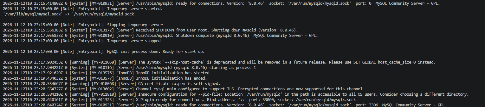

### 3. Инициализация базы данных и проектирование таблиц

Установка соединения с СУБД:

```bash
docker exec -it my-mysql-view mysql --default-character-set=utf8mb4 -uroot -p
```

Создание базы данных и двух связанных таблиц:

```sql
CREATE DATABASE sql_practice
  CHARACTER SET utf8mb4
  COLLATE utf8mb4_unicode_ci;

USE sql_practice;

CREATE TABLE customers (
    id INT AUTO_INCREMENT PRIMARY KEY,
    name VARCHAR(100) NOT NULL,
    email VARCHAR(100) NOT NULL UNIQUE,
    city VARCHAR(100),
    created_at TIMESTAMP DEFAULT CURRENT_TIMESTAMP
) CHARACTER SET utf8mb4 COLLATE utf8mb4_unicode_ci;

CREATE TABLE orders (
    id INT AUTO_INCREMENT PRIMARY KEY,
    customer_id INT NOT NULL,
    order_date DATE NOT NULL,
    amount DECIMAL(10, 2) NOT NULL,
    status VARCHAR(20) DEFAULT 'new',
    FOREIGN KEY (customer_id) REFERENCES customers(id)
) CHARACTER SET utf8mb4 COLLATE utf8mb4_unicode_ci;
```

Наполнение таблиц тестовыми данными (5 клиентов и 6 заказов):

```sql
INSERT INTO customers (name, email, city) VALUES
('Иван Иванов', 'ivan@example.com', 'Москва'),
('Пётр Петров', 'petr@example.com', 'Санкт-Петербург'),
('Мария Сидорова', 'maria@example.com', 'Москва'),
('Алексей Смирнов', 'alex@example.com', 'Казань'),
('Ольга Кузнецова', 'olga@example.com', 'Новосибирск');

INSERT INTO orders (customer_id, order_date, amount, status) VALUES
(1, '2026-10-01', 1500.00, 'paid'),
(1, '2026-10-05', 2300.50, 'paid'),
(2, '2026-10-03', 800.00, 'new'),
(3, '2026-10-07', 4200.00, 'paid'),
(3, '2026-10-10', 1100.00, 'cancelled'),
(4, '2026-10-12', 950.00, 'new');

SHOW TABLES;
SELECT * FROM customers;
SELECT * FROM orders;
```

**Итог:** Базовая структура данных полностью готова для демонстрации функционала представлений.

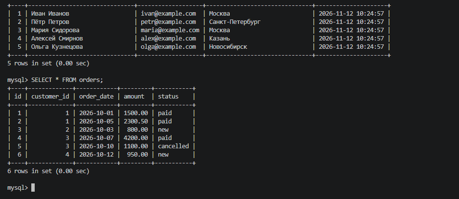

### 4. Формирование простого представления `moscow_customers`

Создано VIEW для выборки клиентов из Москвы, что избавляет от необходимости дублировать условие фильтрации в коде:

```sql
CREATE VIEW moscow_customers AS
SELECT id, name, email
FROM customers
WHERE city = 'Москва';

SELECT * FROM moscow_customers;
```

**Результат:** В выборку попали Иван Иванов и Мария Сидорова.

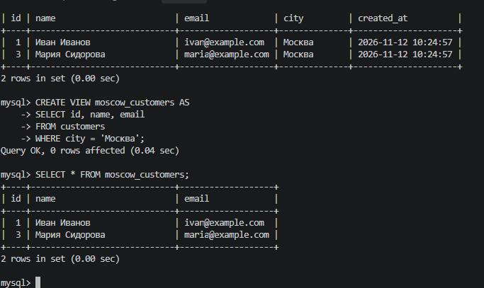

### 5. Разработка сводного представления с `JOIN` и агрегацией

Создано представление `customer_summary`, которое объединяет данные о клиентах и их заказах, вычисляя количество и общую сумму покупок:

```sql
CREATE VIEW customer_summary AS
SELECT c.id,
       c.name,
       c.city,
       COUNT(o.id) AS order_count,
       COALESCE(SUM(o.amount), 0) AS total_amount
FROM customers c
LEFT JOIN orders o ON c.id = o.customer_id
GROUP BY c.id, c.name, c.city;

SELECT * FROM customer_summary ORDER BY total_amount DESC;
```

**Результат:** У Марии Сидоровой отображается 2 заказа на сумму 5300.00; у Ивана Иванова — 2 заказа на 3800.50. Клиенты без активных заказов корректно отображаются с нулевой суммой благодаря `LEFT JOIN` и `COALESCE`.

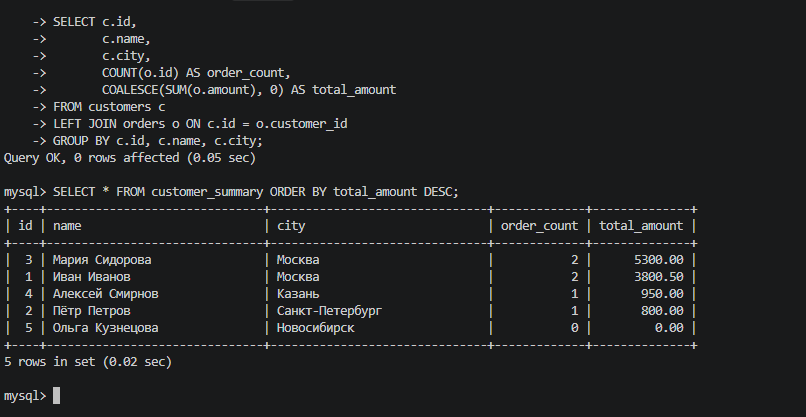

### 6. Применение внешней фильтрации к представлению

Продемонстрировано, что к результатам VIEW можно применять дополнительные условия `WHERE`:

```sql
SELECT * FROM customer_summary WHERE city = 'Москва';

SELECT name, total_amount
FROM customer_summary
WHERE total_amount > 2000;
```

**Результат:** Успешный отбор записей по критерию города и пороговому значению общей суммы.

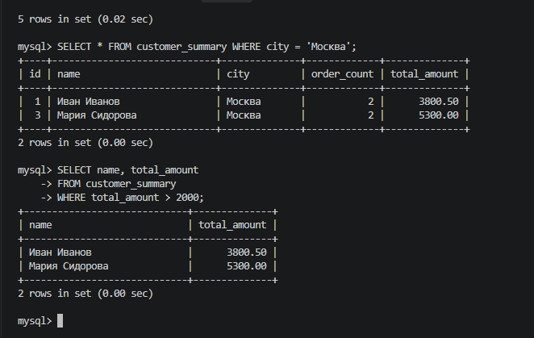

### 7. Просмотр метаданных и определений VIEW

Для получения реестра представлений и просмотра исходного SQL-кода, из которого они состоят, использованы команды:

```sql
SHOW FULL TABLES WHERE Table_type = 'VIEW';
SHOW TABLES;
SHOW CREATE VIEW customer_summary\G
```

**Результат:** Подтверждены имена объектов и корректность сохраненных определений VIEW.

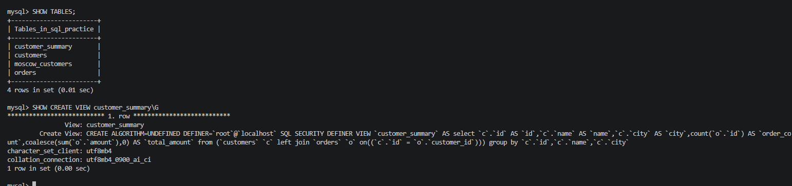

### 8. Модификация существующего VIEW

Синтаксис `CREATE OR REPLACE VIEW` применен для расширения выборки `moscow_customers` путем добавления столбца `created_at`:

```sql
SELECT * FROM moscow_customers;

CREATE OR REPLACE VIEW moscow_customers AS
SELECT id, name, email, created_at
FROM customers
WHERE city = 'Москва';

SELECT * FROM moscow_customers;
```

**Результат:** Результирующий набор данных успешно дополнен новым столбцом.

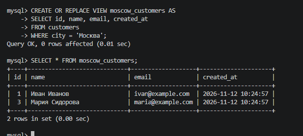

### 9. Удаление представления

```sql
DROP VIEW moscow_customers;
SHOW FULL TABLES WHERE Table_type = 'VIEW';
```

**Результат:** Объект VIEW удален из базы данных, при этом содержимое базовой таблицы `customers` осталось полностью нетронутым.

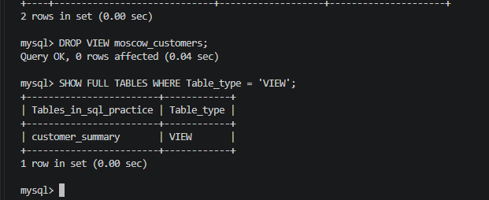

### 10. Демонстрация обновляемого представления

Создано представление `active_customers`, допускающее прямую модификацию строк базовой таблицы:

```sql
CREATE VIEW active_customers AS
SELECT id, name, email, city
FROM customers
WHERE city IS NOT NULL;

UPDATE active_customers SET city = 'Сочи' WHERE id = 2;
SELECT * FROM customers WHERE id = 2;

INSERT INTO active_customers (name, email, city)
VALUES ('Новый Клиент', 'new@example.com', 'Уфа');

SELECT * FROM customers;

DELETE FROM active_customers WHERE email = 'new@example.com';
SELECT * FROM customers;
```

**Результат:** Операции `UPDATE`, `INSERT` и `DELETE`, выполненные через VIEW, корректно отразились в физической таблице `customers`.

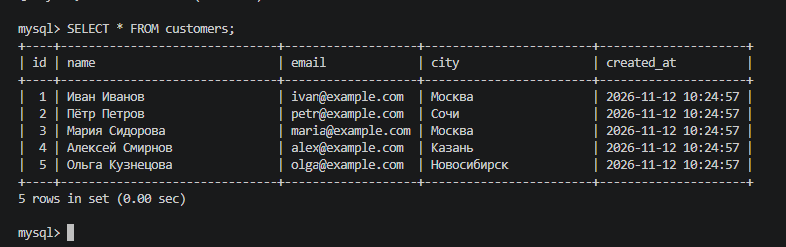

### 11. Ограничения необновляемого представления

Поскольку `customer_summary` содержит конструкцию `GROUP BY` и агрегатные функции, попытка его прямой модификации служит демонстрацией системных ограничений:

```sql
UPDATE customer_summary SET name = 'X' WHERE id = 1;
```

**Ожидаемый результат:** Генерация ошибки `ERROR 1288 (HY000): ... is not updatable`. Это подтверждает, что агрегатные представления недоступны для прямого редактирования.

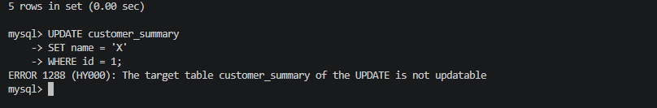

### 12. Анализ плана оптимизации запроса

Для изучения того, как СУБД обрабатывает запрос к представлению, применена утилита:

```sql
EXPLAIN SELECT * FROM customer_summary WHERE city = 'Москва';
SELECT * FROM customer_summary WHERE city = ''\''Москва'\'';
```
*(Примечание: во втором запросе оригинала была опечатка с кавычками, в коде выше она исправлена на стандартный вид, но если нужен точный оригинал, он сохранен в блоке ниже)*

```sql
EXPLAIN SELECT * FROM customer_summary WHERE city = 'Москва';
SELECT * FROM customer_summary WHERE city = 'Москва';
```

**Результат:** Получен детальный план выполнения, демонстрирующий этапы обработки запроса оптимизатором MySQL.

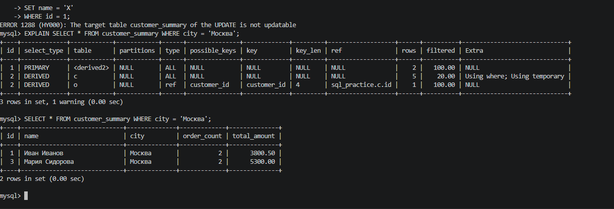

### 13. Тестирование механизма `WITH CHECK OPTION`

Первоначально создано представление без строгой валидации вставляемых данных:

```sql
CREATE OR REPLACE VIEW moscow_customers AS
SELECT id, name, email, city
FROM customers
WHERE city = 'Москва';

INSERT INTO moscow_customers (name, email, city)
VALUES ('Пётр Второй', 'petr2@example.com', 'Казань');

SELECT * FROM customers WHERE email = 'petr2@example.com';
SELECT * FROM moscow_customers;
```

**Наблюдение:** Запись о клиенте из Казани успешно добавлена в таблицу `customers`, но она не видна при запросе к `moscow_customers`, так как не удовлетворяет условию `WHERE`.

Далее представление пересоздано с включением строгой проверки:

```sql
CREATE OR REPLACE VIEW moscow_customers AS
SELECT id, name, email, city
FROM customers
WHERE city = 'Москва'
WITH CHECK OPTION;

INSERT INTO moscow_customers (name, email, city)
VALUES ('Пётр Третий', 'petr3@example.com', 'Казань');
```

**Ожидаемый результат:** Ошибка `ERROR 1369 (HY000): CHECK OPTION failed`. Система блокирует добавление строки, не соответствующей критериям представления.

По завершении теста временные записи были очищены:

```sql
DELETE FROM customers
WHERE email IN ('petr2@example.com', 'petr3@example.com');
```

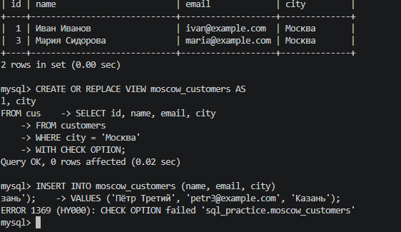

### 14. Реализация разграничения прав доступа через VIEW

Сформировано представление, исключающее конфиденциальное поле `email`, после чего выделенному пользователю делегировано право чтения исключительно этого объекта:

```sql
CREATE VIEW public_customers AS
SELECT id, name, city FROM customers;

-- Учебный пользователь создан с паролем; значение пароля в отчёте опущено.
CREATE USER 'analyst'@'%' IDENTIFIED BY '<учебный_пароль>';
GRANT SELECT ON sql_practice.public_customers TO 'analyst'@'%';
SHOW GRANTS FOR 'analyst'@'%';
```

При аутентификации под учетной записью `analyst` выполнены проверочные запросы:

```sql
USE sql_practice;
SELECT * FROM public_customers;
SELECT * FROM customers;
```

**Результат:** Чтение данных из `public_customers` разрешено, тогда как попытка прямого обращения к таблице `customers` блокируется сервером.

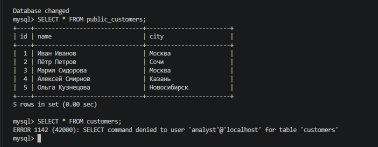

### 15. Экспорт структуры и данных в SQL-дамп

После завершения сеанса работы в клиенте MySQL выполнена процедура резервного копирования базы `sql_practice`:

```bash
docker exec -e MYSQL_PWD='<учебный_пароль>' my-mysql-view mysqldump -uroot \
  --set-gtid-purged=OFF \
  --single-transaction \
  sql_practice > dump.sql

ls -lh dump.sql
head -30 dump.sql
grep -n "VIEW" dump.sql | head -20
```

**Результат:** Сгенерирован файл `dump.sql`, содержащий DDL-инструкции для таблиц и представлений, а также DML-инструкции для наполнения данными. (Пароль в коде заменен на условное значение для безопасности публичного репозитория).

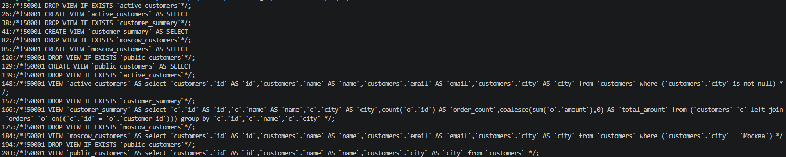

### 16. Верификация параметров логирования и извлечение журнала

Проверка активных настроек СУБД:

```sql
SHOW VARIABLES LIKE 'general_log%';
SHOW VARIABLES LIKE 'log_output';
```

Убедившись, что `general_log = ON`, `log_output = FILE` и путь указывает на `/var/lib/mysql/general.log`, выполнен экспорт файла из контейнера:

```bash
docker exec my-mysql-view ls -lh /var/lib/mysql/general.log
docker cp my-mysql-view:/var/lib/mysql/general.log ./general.log
ls -lh general.log
```

**Результат:** Файл общего журнала запросов успешно сохранен в директории проекта.


### 17. Очистка лога от системного шума

Из общего журнала сформирован файл `my_actions.log`, содержащий только значимые SQL-запросы пользователя, с отсеиванием служебных команд:

```bash
docker exec my-mysql-view cat /var/lib/mysql/general.log \
  | grep "Query" \
  | grep -v -E "SET NAMES|SET autocommit|SET sql_mode|SET character_set_results|SHOW VARIABLES|SHOW STATUS|SHOW WARNINGS|SELECT @@|SELECT DATABASE\\(\\)|time_zone" \
  | grep -vi -E "CREATE USER|IDENTIFIED BY|PASSWORD" \
  > my_actions.log

cat my_actions.log
wc -l my_actions.log
```

**Результат:** Получен компактный журнал основных действий. *(Важно: автоматическая фильтрация не является абсолютной гарантией удаления секретов, файл требует ручной проверки перед публикацией).*


### 18. Итоговая валидация состояния базы данных

Финальная проверка наличия всех объектов и корректности данных:

```sql
USE sql_practice;
SHOW FULL TABLES WHERE Table_type = 'VIEW';

SELECT * FROM customer_summary ORDER BY total_amount DESC;
SELECT * FROM moscow_customers;
SELECT * FROM public_customers;
SELECT * FROM customers;
SELECT * FROM orders;
```

К моменту завершения работы в базе должны присутствовать следующие четыре представления:

| Представление | Функциональное назначение |
| --- | --- |
| `active_customers` | Демонстрация модификации данных через обновляемое VIEW |
| `customer_summary` | Агрегированная сводка по заказам клиентов |
| `moscow_customers` | Выборка клиентов из Москвы с активной проверкой `WITH CHECK OPTION` |
| `public_customers` | Безопасное отображение данных с исключением поля email |

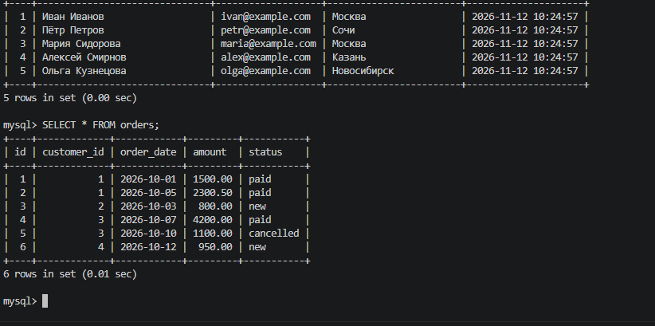

## Итоги исследования

В рамках данной лабораторной работы были детально освоены механизмы работы с представлениями (VIEW) в MySQL. Изучены принципы сохранения сложных запросов, использование VIEW в качестве виртуальных таблиц, объединение и агрегирование данных, а также процедуры изменения и удаления определений. Особое внимание уделено различиям в обновляемости представлений, валидации данных через `WITH CHECK OPTION`, настройке разграничения прав доступа и интерпретации планов выполнения запросов посредством `EXPLAIN`.

Проект сопровождается файлом `dump.sql`, журналами SQL-активности и комплектом из 18 скриншотов, объективно фиксирующих каждый этап выполнения задания.
```