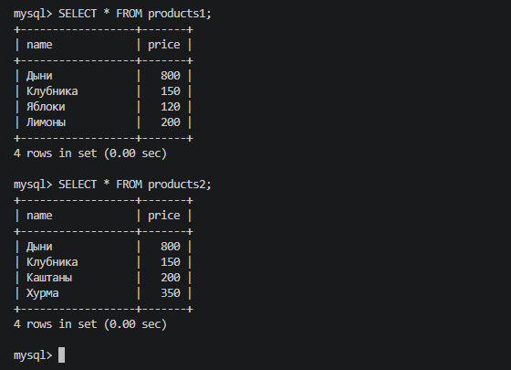
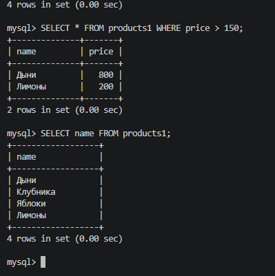
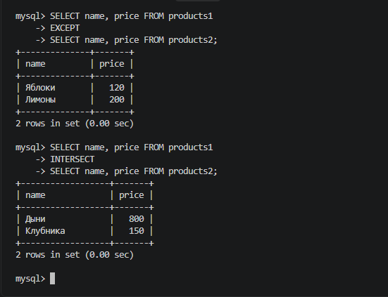
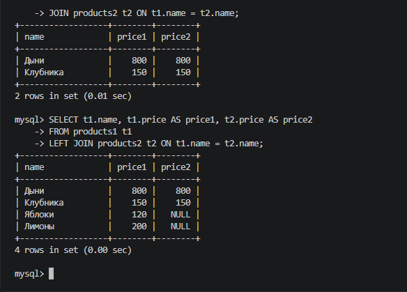
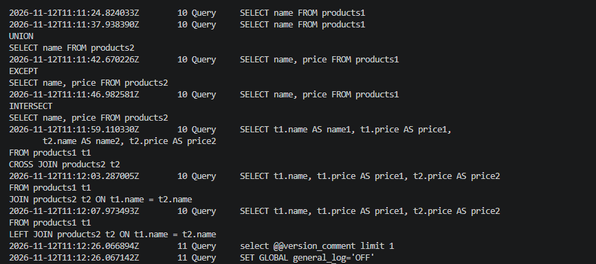
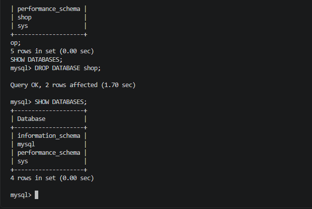
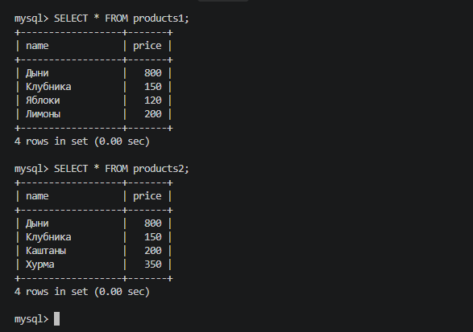

# Лабораторная работа № 4: Базовые SQL-операции в MySQL

Учебный проект по дисциплине **«Основы проектирования баз данных»**: проектирование двух таблиц товаров в среде MySQL 8.0, выполнение операций реляционной алгебры над данными и множествами, а также отработка процедур резервного копирования и восстановления базы данных в контейнере Docker.

## Постановка задачи

**Учебное пособие:** [Основные SQL-операции на примере двух таблиц «products 1» и «products 2»](https://github.com/rurewa/imfua/blob/main/content/Courses/Basics_database_design/content/bd/Products.md)

**Цель исследования:** Закрепить практические навыки работы с операторами `SELECT`, проекцией данных, множествами (`UNION`, `EXCEPT`, `INTERSECT`), а также механизмами соединения таблиц (`CROSS JOIN`, `JOIN`, `LEFT JOIN`). Отработать полный цикл управления данными: создание SQL-дампа, удаление базы и её последующую реставрацию.

**Технологический стек:** ОС Windows, подсистема WSL (Ubuntu), Docker Desktop, СУБД MySQL 8.0, редактор VS Code, система контроля версий Git.

## Реализованные задачи

1. Организовано изолированное рабочее пространство `products-mysql`, настроен файл `my.cnf` с поддержкой кодировки `utf8mb4` и активировано файловое логирование запросов.
2. Развернут Docker-контейнер `products-mysql`; инициализирована база данных `shop` и созданы таблицы `products1`, `products2`.
3. Таблицы наполнены тестовыми наборами данных (по 4 записи в каждой).
4. Протестированы ключевые SQL-конструкции: фильтрация, выборка конкретных столбцов, объединение, разность, пересечение множеств и различные типы соединений таблиц.
5. Зафиксирована история выполненных команд в файлах `general.log` и `my_actions.log`.
6. Сгенерирован резервный дамп `dump.sql`, после чего база `shop` была удалена и успешно восстановлена из созданной копии.

## Архитектура проекта

```text
products-mysql/
├── README.md
├── my.cnf
├── dump.sql
├── general.log
├── my_actions.log
└── screenshots/
    ├── 01-container.png
    ├── 02-data.png
    ├── 03-select.png
    ├── 04-sets.png
    ├── 05-joins.png
    ├── 06-log.png
    ├── 07-dump.png
    ├── 08-drop.png
    └── 09-restore.png
```

## Ход выполнения работы

### 1. Инициализация окружения и запуск СУБД

Разработан конфигурационный файл `my.cnf`, обеспечивающий корректную работу с кириллицей и направляющий общий журнал запросов в файл:

```ini
[mysqld]
character-set-server = utf8mb4
collation-server = utf8mb4_unicode_ci
general_log = 1
general_log_file = /var/lib/mysql/general.log
log_output = FILE

[client]
default-character-set = utf8mb4

[mysql]
default-character-set = utf8mb4
```

Контейнер развернут на базе официального образа `mysql:8.0` с использованием выделенного именованного тома `products_mysql_data` и подключенной конфигурации:

```bash
docker run --name products-mysql \
  -e MYSQL_ROOT_PASSWORD=123 \
  -e LANG=C.UTF-8 \
  -e MYSQL_INITDB_SKIP_TZINFO=1 \
  -v products_mysql_data:/var/lib/mysql \
  -v "$HOME/mysql-products-config/my.cnf:/etc/mysql/conf.d/my.cnf:ro" \
  -d mysql:8.0

docker ps
```

> **Примечание:** Пароль `123` используется исключительно в учебных целях. В промышленных средах необходимо применять криптографически стойкие пароли.


### 2. Проектирование базы данных и наполнение таблиц

В среде MySQL создана база `shop` с указанием кодировки `utf8mb4`, а также две таблицы с атрибутами `name` и `price`, которые были заполнены тестовыми данными:

```sql
CREATE DATABASE shop
  CHARACTER SET utf8mb4
  COLLATE utf8mb4_unicode_ci;
USE shop;

CREATE TABLE products1 (
    name VARCHAR(100) NOT NULL,
    price INT NOT NULL
);

CREATE TABLE products2 (
    name VARCHAR(100) NOT NULL,
    price INT NOT NULL
);

INSERT INTO products1 (name, price) VALUES
('Дыни', 800),
('Клубника', 150),
('Яблоки', 120),
('Лимоны', 200);

INSERT INTO products2 (name, price) VALUES
('Дыни', 800),
('Клубника', 150),
('Каштаны', 200),
('Хурма', 350);

SHOW TABLES;
SELECT * FROM products1;
SELECT * FROM products2;
```

Каждая таблица содержит по четыре записи. Идентичные позиции в обоих наборах: **дыни** и **клубника**.



### 3. Фильтрация и проекция данных

Демонстрация выборки товаров из первой таблицы со стоимостью выше 150:

```sql
SELECT * FROM products1 WHERE price > 150;
```

Проекция данных — извлечение исключительно столбца `name`:

```sql
SELECT name FROM products1;
```

В результате фильтрации по цене возвращаются записи о **дынях** и **лимонах**.



### 4. Множественные операции: UNION, EXCEPT, INTERSECT

Оператор `UNION` формирует набор уникальных названий из обеих таблиц:

```sql
SELECT name FROM products1
UNION
SELECT name FROM products2;
```

Оператор `EXCEPT` выявляет записи, присутствующие исключительно в первой таблице:

```sql
SELECT name, price FROM products1
EXCEPT
SELECT name, price FROM products2;
```

Оператор `INTERSECT` находит пересечение, то есть записи, идентичные в обеих таблицах:

```sql
SELECT name, price FROM products1
INTERSECT
SELECT name, price FROM products2;
```

| Операция | Результат на тестовых данных |
|---|---|
| `UNION` | 6 уникальных наименований |
| `EXCEPT` | Яблоки, лимоны |
| `INTERSECT` | Дыни, клубника |

> **Важно:** Операции `EXCEPT` и `INTERSECT` поддерживаются в MySQL начиная с версии 8.0.31.



### 5. Механизмы соединения таблиц: CROSS JOIN, JOIN и LEFT JOIN

`CROSS JOIN` генерирует декартово произведение множеств: 4 товара × 4 товара = **16 возможных пар**.

```sql
SELECT t1.name AS name1, t1.price AS price1,
       t2.name AS name2, t2.price AS price2
FROM products1 t1
CROSS JOIN products2 t2;
```

`JOIN` (внутреннее соединение) отображает только те товары, названия которых совпадают в обеих таблицах:

```sql
SELECT t1.name, t1.price AS price1, t2.price AS price2
FROM products1 t1
JOIN products2 t2 ON t1.name = t2.name;
```

`LEFT JOIN` (левое внешнее соединение) сохраняет все записи из первой таблицы, дополняя их данными из второй. Если пары нет, подставляются значения `NULL`:

```sql
SELECT t1.name, t1.price AS price1, t2.price AS price2
FROM products1 t1
LEFT JOIN products2 t2 ON t1.name = t2.name;
```

В последнем запросе для яблок и лимонов значение цены из второй таблицы будет равно `NULL`.



### 6. Фиксация истории SQL-запросов

Для аудита выполненных действий задействован механизм общего логирования MySQL. В проект экспортированы два файла:

- `general.log` — полный журнал запросов, извлеченный из контейнера;
- `my_actions.log` — отфильтрованная выборка, содержащая только учебные команды.

```bash
docker cp products-mysql:/var/lib/mysql/general.log ./general.log
```

Верификация содержимого файлов:

```bash
ls -lh general.log my_actions.log
cat my_actions.log
```



### 7. Формирование резервной копии (бэкапа)

С помощью утилиты `mysqldump` создана полная копия структуры и данных базы `shop` в формате SQL:

```bash
docker exec -e MYSQL_PWD=123 products-mysql mysqldump -uroot \
  --set-gtid-purged=OFF \
  --single-transaction \
  shop > dump.sql
```

Проверка наличия инструкций создания и наполнения таблиц в файле:

```bash
ls -lh dump.sql
grep -nE 'CREATE TABLE|INSERT INTO' dump.sql | head -10
```


### 8. Ликвидация базы данных

После успешного создания резервной копии выполнено принудительное удаление базы `shop`:

```sql
SHOW DATABASES;
DROP DATABASE shop;
SHOW DATABASES;
```

В результате выполнения база `shop` исчезает из реестра доступных баз данных.



### 9. Реставрация базы данных из резервной копии

На первом этапе заново инициализирована пустая база данных:

```sql
CREATE DATABASE shop
  CHARACTER SET utf8mb4
  COLLATE utf8mb4_unicode_ci;
```

Далее, через терминал WSL, выполнен импорт данных из файла `dump.sql`:

```bash
docker exec -i -e MYSQL_PWD=123 products-mysql mysql -uroot shop < dump.sql
```

Финальная верификация после восстановления:

```sql
USE shop;
SHOW TABLES;
SELECT * FROM products1;
SELECT * FROM products2;
```

Обе таблицы успешно воссозданы с исходным набором записей.



## Итоги работы

В ходе выполнения лабораторной работы были детально изучены принципы выборки строк, проекции столбцов, а также операции над множествами (объединение, разность, пересечение), декартово произведение и различные типы соединений таблиц (внутреннее и левое внешнее). На примере базы `shop` отработан полный жизненный цикл данных: от создания и наполнения таблиц до экспорта дампа, принудительного удаления и последующей реставрации.

В директории проекта размещены **файл дампа, журналы SQL-активности и девять скриншотов**, документирующих ключевые этапы выполнения. Полученные компетенции демонстрируют понимание того, как MySQL реализует базовые операции реляционной алгебры и как обеспечить сохранность данных для аварийного восстановления.
```