# Практическая работа № 1: Интерактивное взаимодействие с MySQL в Docker

**Тема:** Практическое применение MySQL в изолированной среде Docker.

**Исходное задание:** [«Интерактивное взаимодействие с MySQL в изолированной среде Docker № 1»](https://gitflic.ru/project/rurewa/mfua/blob?file=content/Database/mysql_docker_1.md&branch=master)

## Цели практической работы

Освоить запуск СУБД MySQL внутри Docker-контейнера, подключение к ней через консоль, создание баз данных и таблиц, выполнение базовых SQL-команд, настройку логирования запросов, а также создание резервных копий (дампов) баз данных.

## Выполненные задачи

- Подготовлена среда Docker и инициализирована рабочая директория проекта `mysql-docker-practice`.
- Сконфигурирован MySQL с помощью файла `my.cnf`: установлена кодировка `utf8mb4` и активировано логирование SQL-запросов.
- Инициирован контейнер `my-mysql` из образа `mysql:8.0` с подключенным именованным томом `mysql_data`.
- Отработаны основные SQL-команды: `SHOW`, `CREATE`, `INSERT`, `SELECT`, `UPDATE`, `DELETE` и `DROP`.
- Сформирована тестовая база данных `sql_practice` и создан её дамп в файл `dump.sql`.
- Экспортированы общий журнал запросов `general.log` и системные логи контейнера в `log.txt`.
- Протестированы процессы остановки и последующего перезапуска контейнера.

## Структура файлов проекта

```text
mysql-docker-practice/
├── README.md
├── my.cnf
├── dump.sql
├── general.log
├── log.txt
└── screenshots/
    ├── 01-cleanup.png
    ├── 02-run.png
    ├── 03-ps.png
    ├── 04-show-databases.png
    ├── 05-create-table.png
    ├── 06-update.png
    ├── 07-delete.png
    ├── 08-drop.png
    ├── 09-dump.png
    ├── 10-dump-content.png
    ├── 11-log.png
    └── 12-manage.png
```

## Пошаговое выполнение работы

### 1. Подготовка среды Docker

Выполнен анализ активных контейнеров, после чего запущенные экземпляры были остановлены, а неиспользуемые ресурсы Docker удалены.

```bash
docker ps -a
docker stop $(docker ps -q)
docker container prune -f
docker volume prune -f
```


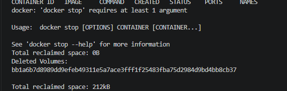

### 2. Конфигурация и старт MySQL

В рабочей директории проекта был сгенерирован файл `my.cnf`, определяющий параметры кодировки и правила логирования запросов:

```ini
[mysqld]
character-set-server = utf8mb4
collation-server = utf8mb4_unicode_ci
general_log = 1
general_log_file = /var/lib/mysql/general.log
log_output = FILE

[client]
default-character-set = utf8mb4

[mysql]
default-character-set = utf8mb4
```

Произведен запуск контейнера MySQL 8.0 с привязкой данных к именованному тому `mysql_data` для их сохранности:

```bash
docker run --name my-mysql \
  -e MYSQL_ROOT_PASSWORD=123 \
  -e LANG=C.UTF-8 \
  -v mysql_data:/var/lib/mysql \
  -v $(pwd)/my.cnf:/etc/mysql/conf.d/my.cnf \
  -d mysql:8.0
```

Значение пароля `123` применяется исключительно в демонстрационных целях.


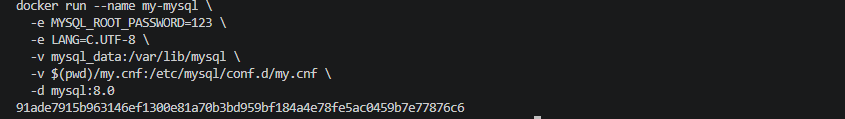

### 3. Верификация состояния контейнера

С помощью команды `docker ps` подтверждено, что контейнер `my-mysql` находится в активном состоянии.

```bash
docker ps
```

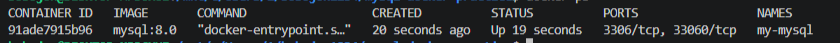

### 4. Подключение к СУБД и просмотр списка баз данных

Осуществлен вход в интерактивную консоль MySQL от имени суперпользователя `root`:

```bash
docker exec -it my-mysql mysql --default-character-set=utf8mb4 -uroot -p
```

После успешной аутентификации была запрошена информация о доступных базах данных:

```sql
SHOW DATABASES;
```

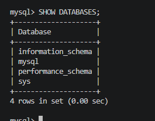

### 5. Формирование базы данных, таблицы и наполнение её данными

Была инициирована база данных `my_database` с набором символов `utf8mb4`, после чего создана таблица `users`, содержащая колонки `id`, `name` и `email`. В таблицу внесены три тестовых строки, и выполнен запрос для их визуализации.

```sql
CREATE DATABASE my_database
  CHARACTER SET utf8mb4
  COLLATE utf8mb4_unicode_ci;

USE my_database;

CREATE TABLE users (
    id INT AUTO_INCREMENT PRIMARY KEY,
    name VARCHAR(100) NOT NULL,
    email VARCHAR(100) NOT NULL UNIQUE
) CHARACTER SET utf8mb4 COLLATE utf8mb4_unicode_ci;

INSERT INTO users (name, email) VALUES
  ('Иван Иванов', 'ivan@example.com'),
  ('Пётр Петров', 'petr@example.com'),
  ('Мария Сидорова', 'maria@example.com');

SELECT * FROM users;
```

Стоит отметить, что в MySQL 8.0 для подобных таблиц движком хранения по умолчанию выступает InnoDB.


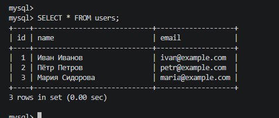

### 6. Вставка и модификация данных

В существующую таблицу был добавлен дополнительный пользователь, а затем обновлено имя пользователя с `id = 1`. Корректность изменений подтверждена через запрос `SELECT`.

```sql
INSERT INTO users (name, email)
VALUES ('Павел Иванов', 'pavel@example.com');

UPDATE users SET name = 'Иван Петров' WHERE id = 1;

SELECT * FROM users;
```


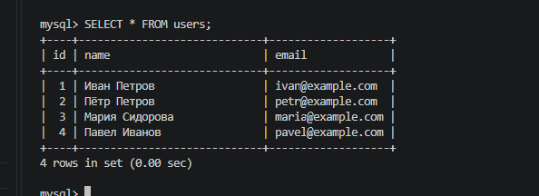

### 7. Удаление конкретной записи

Произведено удаление строки с `id = 2`, вслед за чем было запрошено актуальное содержимое таблицы.

```sql
DELETE FROM users WHERE id = 2;
SELECT * FROM users;
```

Использование условия `WHERE` гарантирует, что удалению подвергнется только указанная строка.


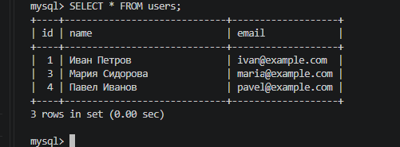

### 8. Ликвидация таблицы и базы данных

По завершении базовых манипуляций таблица `users` и учебная база `my_database` были удалены. Затем повторно запрошен перечень доступных баз данных.

```sql
DROP TABLE users;
DROP DATABASE my_database;
SHOW DATABASES;
```

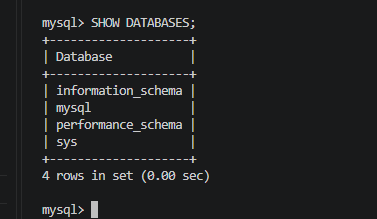

### 9. Генерация тестовой базы и SQL-дампа

С целью демонстрации механизмов резервного копирования была развернута отдельная база `sql_practice`, содержащая таблицу `test` с единственной записью:

```bash
docker exec -i my-mysql mysql -uroot -p123 -e "CREATE DATABASE IF NOT EXISTS sql_practice; USE sql_practice; CREATE TABLE test (id INT, name VARCHAR(50)); INSERT INTO test VALUES (1, 'hello');"
```

Далее содержимое базы данных было экспортировано в файл `dump.sql`:

```bash
docker exec my-mysql mysqldump -uroot -p123 --set-gtid-purged=OFF sql_practice > dump.sql
```


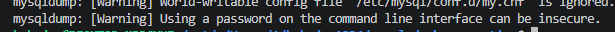

### 10. Анализ содержимого файла дампа

Убедились, что файл `dump.sql` включает в себя необходимые SQL-директивы для воссоздания структуры и наполнения базы данных.

```bash
cat dump.sql | head -20
```


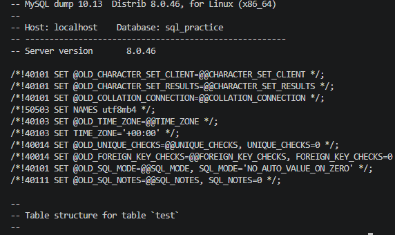

### 11. Извлечение журнала SQL-запросов

За счет активации параметра `general_log = 1` СУБД MySQL фиксирует все события в файле `/var/lib/mysql/general.log`. Данный журнал был извлечен на хост-машину:

```bash
docker cp my-mysql:/var/lib/mysql/general.log ./general.log
```

### 12. Администрирование контейнера и экспорт логов

Протестированы механизмы остановки и последующего возобновления работы MySQL-контейнера. Вывод команды `docker logs` был перенаправлен и сохранен в отдельный текстовый файл.

```bash
docker stop my-mysql
docker start my-mysql
docker logs my-mysql > log.txt
```

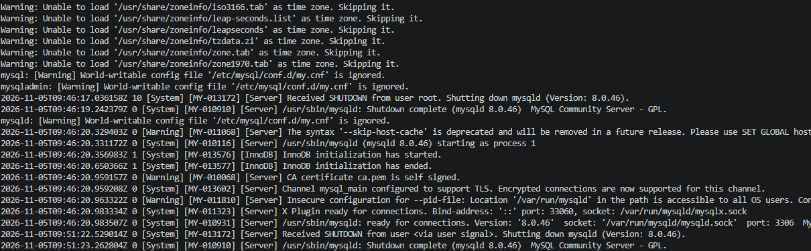

## Итоги работы

В ходе выполнения практического задания успешно применены технологии Docker, СУБД MySQL 8.0 и движок хранения InnoDB. Были отработаны навыки подключения к базе данных, создания и удаления таблиц и баз данных, манипуляции записями (выборка, обновление, удаление), формирования SQL-дампов, анализа журналов событий и администрирования Docker-контейнера.

## Заключение

Проделанная работа позволила закрепить фундаментальные навыки администрирования СУБД MySQL в среде Docker: от первоначальной конфигурации и старта контейнера до исполнения SQL-команд, формирования резервных копий и экспорта логов. Применение именованного тома Docker гарантирует, что файлы базы данных сохраняются независимо от жизненного цикла самого контейнера.